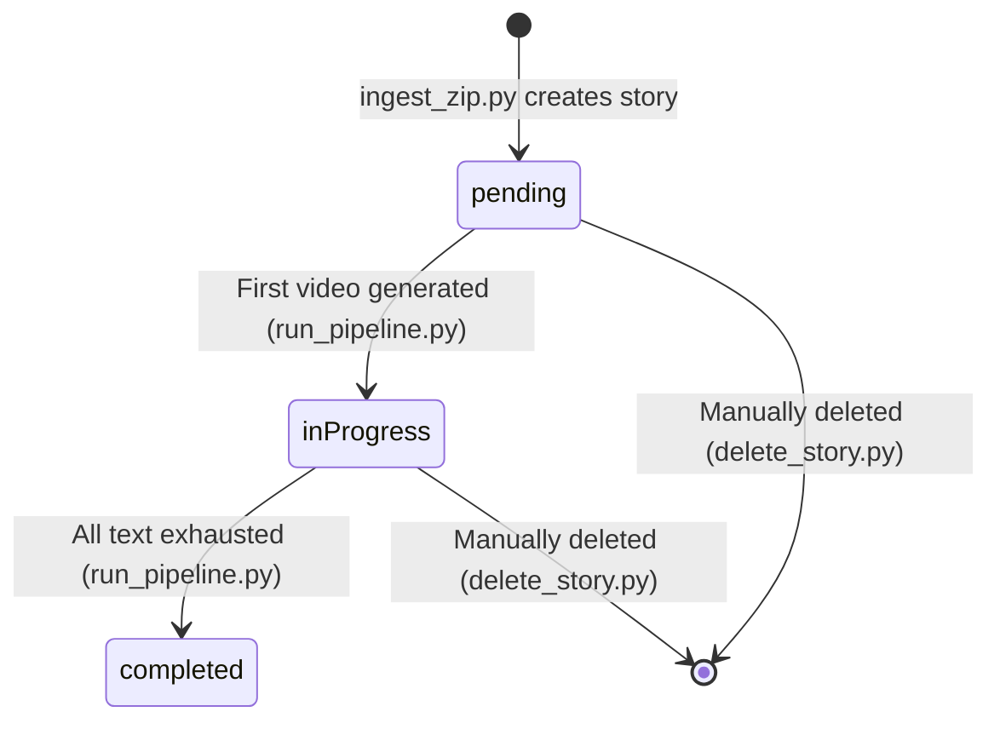

# Exhaustive Start-to-Finish System Guide

This is the definitive operational manual and testing guide for ShortsForge V2. It details exactly what to run, what parameters to use, and the underlying database and filesystem behaviors at every step.

---

## Phase 0: Master Autopilot & Email Notifications
You can bypass running the individual phases manually by using the Master Orchestrator, which chains the entire process together securely and automatically.

### Configuring Notifications
Before using the Autopilot, you must configure your `.env` file to enable Crash Alerts and Daily Success Reports.
1. Create or open the `.env` file in the root of your project: `d:\Projects\shortsforge-platform\.env`.
2. Add your Gmail credentials. **You must use an App Password, not your real password.**
```env
SMTP_EMAIL=your_actual_gmail@gmail.com
SMTP_PASSWORD=your_16_digit_app_password
ALERT_EMAIL=where_you_want_to_receive_alerts@gmail.com
```
*(To get an App Password: Go to Google Account > Security > 2-Step Verification > App Passwords. Name it ShortsForge and copy the 16-letter code without spaces).*

3. **Test the Mailer:**
```bash
python scripts/utils/mailer.py
```
*(You should see "Test email sent successfully!" in your terminal and receive an email instantly).*

### Setting up Google Drive Backups (Free)
Because of strict Google API limits on free personal accounts, we use standard User Authentication instead of a Service Account.
1. Make sure you have completed the YouTube OAuth setup in Phase 1 (i.e. you have your `client_secret.json` in the `data/credentials/` folder).
2. Go to the [Google Cloud Console](https://console.cloud.google.com/) and go to "APIs & Services" > "Library".
3. Search for **Google Drive API** and click "Enable".
4. Go to your normal Google Drive, create a folder named "ShortsForge Backups".
5. Extract the Folder ID from the URL (the long string of letters/numbers after `/folders/`) and put it in your `.env` file as `DRIVE_BACKUP_FOLDER_ID=your_id`.

When you run the backup uploader for the first time, it will open your browser to log in, just like the YouTube uploader did! It saves a `drive_token.json` so it runs automatically in the background forever after that.

### Testing the Backup System Manually
If you want to test the backup and upload scripts individually without running the entire Autopilot:

1. **Test Local Backup Only:**
```bash
python scripts/utils/backup_manager.py
```
*(This will generate a zip file in `data/backups/` and print the exact path).*

2. **Test Google Drive Upload Only:**
```bash
python scripts/utils/upload_to_drive.py path/to/your/zipfile.zip
```
*(Replace `path/to/your/zipfile.zip` with the actual path printed from the local backup test. It will upload the file to your Google Drive).*

### Running the Autopilot
**Command:**
```bash
python scripts/autopilot.py
```
**Under the Hood Behavior:**
1. Runs the Scraper (`main.py`) to fetch new stories.
2. Runs the Zipper (`zip_folder.py`) on output channels.
3. Runs the Ingester (`ingest_zip.py --auto`) to safely insert texts into the DB, automatically skipping duplicates.
4. Runs the Video Generator (`run_pipeline.py`) to convert backlogs into .mp4 files.
5. Runs the Uploader (`run_upload.py`) to push them to YouTube.
6. Catches all terminal logs, compiles them into a clean HTML format, attaches any newly generated Shorts thumbnails for mobile uploading, and emails you a Daily Summary Report.

---

## Phase 1: Environment & Channel Setup
Before you can generate content, you must define the target YouTube channels and configure your YouTube API credentials.

### `client_secret.json` (YouTube OAuth)
To upload videos automatically to YouTube, your server needs permission.
1. Go to the [Google Cloud Console](https://console.cloud.google.com/).
2. Under "APIs & Services", enable the **YouTube Data API v3**.
3. Go to "Credentials" -> "Create Credentials" -> **OAuth client ID** (Choose "Desktop App").
4. Download the JSON file, rename it to exactly `client_secret.json`, and place it in your `data/credentials/` folder.
*(Note: `data/credentials/` is ignored by Git in `.gitignore` so it is perfectly safe to put it here, even on an Oracle server).*

### `add_channel.py`
**Purpose:** Registers a YouTube channel in the DB, configures all its stylistic preferences, scaffolds the folder structure, and optionally authorizes YouTube OAuth for automatic uploads.

**Command:**
`python scripts/add_channel.py --channel my_scary_channel`

**Under the Hood Behavior:**
1. **Interactive Configuration:** The script will prompt you to configure the channel's DNA:
   - **Voice Preference:** Choose from 6 different TTS voices (e.g., `male_narrator`, `female_storyteller`).
   - **Visual Style:** `classic` (static image) or `dynamic` (AutoPilot V3 scene-by-scene visuals).
   - **Subtitle Style:** `classic` (standard lower-thirds) or `capcut` (bouncy, karaoke-style center screen).
   - **Background Music:** Enable/disable intense BGM.
   - **Format:** `vertical` (Shorts) or `horizontal` (Long-form videos).
2. **Database:** INSERTS a row into the `channels` table with `id = 'my_scary_channel'`, quotas, and the `voice_config` JSON.
3. **Filesystem:** Scaffolds directories:
   - `data/raw_stories/my_scary_channel/`
   - `data/backgrounds/my_scary_channel/`

---

## Phase 2: Content Ingestion
You write your stories in text files (e.g., `1.txt`, `2.txt`) inside a folder representing the Story Topic, inside the Channel folder. You zip this up and upload it.

### The Passthrough Metadata Feature (`meta.json`)
If you are scraping exact stories from the internet (like Reddit or YouTube) and do NOT want the AI to rewrite your Hook, Description, YouTube Title, or Story Grammar, you can place a `meta.json` file right next to your `1.txt` file before zipping it:

```json
{
    "hook": "This is exactly what I want the big hook text to say!",
    "title": "My custom YouTube Title",
    "description": "My custom YouTube Description",
    "bypass_ai_grammar": true
}
```

**What these flags do:**
1. **`hook`**: Prevents the AI from automatically generating a short hook. It uses your string instead.
2. **`title`**: Prevents the AI from automatically generating a YouTube title.
3. **`description`**: Prevents the AI from automatically generating a YouTube description.
4. **`bypass_ai_grammar`**: Prevents the AI from rewriting your story text to simplify vocabulary or idioms. Instead, it triggers the "Safe AI" sanitization mode, which acts purely as a Regex filter to remove Markdown (`**`, `#`) and emojis without altering a single word of your narrative. This is essential for maintaining Reel-to-YouTube funnel continuity.*

### `ingest_zip.py`
**Purpose:** Unzips the text and JSON files, organizes them, and registers them deeply into the relational database.

**Command:**
`python scripts/story_maker/ingest_zip.py path/to/your/upload.zip`

**Under the Hood Behavior:**
1. **Channel Validation:** It checks if the Channel folder matches an existing channel in the DB. If it doesn't, it prints a warning and **skips** those files.
2. **Filesystem:** Unzips the valid `.txt` files and seamlessly copies any `.json` metadata files alongside them into `data/raw_stories/{Channel}/{Topic}/`.
3. **Database (`story_series`):** It checks if the Topic folder exists in the DB. If not, it creates a new Series with `assigned_quota = 0` and `status = 'pending'`.
4. **Database (`story_parts`):** It registers each text file. It extracts the number from the file name (e.g., `2.txt` -> `sequence_order = 2`).

---

## Phase 3: Quota Management (Dynamic Hierarchy)

All quotas are now **dynamic tokens stored in the database**, not static CLI arguments. The hierarchy is strictly enforced:

```
Global >= SUM(All Channel Quotas)
Channel >= SUM(All Story Quotas within that channel)
```

### View the Full Hierarchy Tree
```bash
python scripts/story_maker/manage_queue.py list
```
**Output Example:**
```
=== Quota Hierarchy Tree ===
[GLOBAL] Gen Limit: 20 | Upload Limit: 10

  └─ [CHANNEL] scary_stories (ID: ch1) - Gen Quota: 5 | Upload Quota: 3
       └─ [STORY 1] Haunted Mansion... (inProgress) - Quota: 3
       └─ [STORY 2] Ghost Ship... (pending) - Quota: 0
  └─ [CHANNEL] funny_cats (ID: ch2) - Gen Quota: 0 | Upload Quota: 0
       └─ [STORY 3] Cat vs Cucumber... (pending) - Quota: 0
============================
```

> [!IMPORTANT]
> Stories are sorted: **Priority (quota > 0) first**, then **inProgress before pending**, then **by ID ascending**.

### Set Global Quotas
```bash
python scripts/story_maker/manage_queue.py set-global --gen 20 --upload 10
```
- Validates: `new_global >= SUM(all channel quotas)`. Blocks if violated.

### Set Channel Quotas
```bash
python scripts/story_maker/manage_queue.py set-channel ch1 --gen 5 --upload 3
```
- **Upward check:** `SUM(other channels) + new_value <= Global`. Blocks if violated.
- **Downward check:** `new_value >= SUM(active story quotas in channel)`. Blocks if violated.

### Set Story Priority
```bash
python scripts/story_maker/manage_queue.py set-story 1 --quota 3
```
- Validates: `SUM(other stories in channel) + new_value <= Channel Gen Quota`. Blocks if violated.

> [!CAUTION]
> **Option 1 Rule:** You can never create an illegal state. To raise a child, the parent must already have room. To lower a parent, the children must already be lowered first.

---

## Phase 4: The Generation Pipeline
This is the core engine that turns raw text into mp4 files.

### `run_pipeline.py`
**Purpose:** Fetches background media, JIT processes AI grammar, extracts shorts, and builds videos — all governed by the dynamic quota hierarchy.

**Command:**
```bash
python scripts/story_maker/run_pipeline.py [--verbose] [--video-dim FLOAT] [--thumb-dim FLOAT]
```
- `--verbose`: Enable detailed dev-style logging.
- `--video-dim`: Brightness adjustment for videos (default: -0.15).
- `--thumb-dim`: Brightness adjustment for thumbnails (default: -0.35).

**Customizing Dimming Levels:**
You have granular control over exactly how much dimming is applied.
- **Defaults:** If you don't pass any arguments, videos are darkened by 15% and thumbnails by 35%.
- **Disable Entirely:** Pass `0` to remove the filter entirely.
  `python scripts/story_maker/run_pipeline.py --video-dim 0 --thumb-dim 0`
- **Make Darker:** Increase the negative float.
  `python scripts/story_maker/run_pipeline.py --video-dim -0.50 --thumb-dim -0.80`
- **Make Brighter:** Pass a positive float to brighten the original image.
  `python scripts/story_maker/run_pipeline.py --video-dim 0.20 --thumb-dim 0.40`

**Under the Hood Behavior:**

#### Step 1: Global Gate
- Reads `global_gen_quota` from `global_settings`. If `0`, immediately exits.

#### Step 2: Channel-First Fetching
- Fetches active channels sorted by: `channel_gen_quota DESC, id ASC`.
- For each channel, fetches its active stories sorted by: `assigned_quota DESC, inProgress before pending, id ASC`.
- This builds a tree: `[{channel: {...}, stories: [...]}, ...]`.

#### Step 3: Work Loop (Priority-to-Default Waterfall)
The pipeline picks the **first channel** (highest priority), then picks the **first story** in that channel (highest priority). It generates **one video**, then:

1. **In-Memory Tracking:** The script increments its temporary `generated_count` and internal trackers for the channel and story. The database quota numbers are **NEVER decremented** (they are permanent rules).
2. **Status Transition:** If the story was `pending`, it becomes `inProgress` (saved to DB).

#### Step 4: Eviction Rules
- **Story eviction:** If a story's internal generation count reaches its `assigned_quota` (if > 0), it is **evicted** from the current run.
- **Channel eviction:** If a channel's internal generation count reaches its `channel_gen_quota` (if > 0), the **entire channel** is evicted from the current run.
- **Default mode (quota = 0):** If a story/channel started at 0, it stays in the queue and keeps processing sequentially until its text is exhausted or the Global Quota limit is hit.
- **Channel exhaustion:** If a channel runs out of active stories entirely, the pipeline auto-resets both `channel_gen_quota` and `channel_upload_quota` to `0` in the database.

#### Step 5: Story Completion
- When `process_series()` returns `False` (no more text/parts), the story is marked `status = 'completed'` and `assigned_quota = 0` in the database.

#### Step 6: Global Halt
- If the internal `generated_count` reaches the static `global_gen_quota` rule, the entire pipeline immediately stops.

#### Content Generation Details
- **Infographic Engine (AutoPilot V3):** If a channel is set to `infographic` or `infographic_record` visuals, the AI acts as a video producer and constructs a precise JSON layout with animated visual nodes (`icon`, `bubble`, `arrow`, `line`). These nodes are mapped to 5 screen slots (center, top, bottom, left, right). The system then uses Playwright Chromium and Anime.js to dynamically render the nodes on an HTML canvas, perfectly syncing the animations to the 5-word pacing rule parsed from the audio's word-level timestamps (`.srt`). 
- **Dynamic Scene Visuals (AutoPilot V3):** If a channel is set to `dynamic` visuals, the AI will split the text into distinct scenes (e.g., "[SCENE 1: A dark forest]", "[SCENE 2: A glowing sword]") and generate a custom AI image for every single scene. The pipeline seamlessly stitches these together to match the exact audio duration of each sentence. 
- **The Media Engine (DuckDuckGo & SafeSearch):** If `dynamic` and `infographic` visuals are disabled, the system falls back to DuckDuckGo Internet Scraping to find a single background image. This honors strict SafeSearch rules to completely prevent NSFW image generation. You can optionally completely disable internet scraping via the `ENABLE_INTERNET_SCRAPING` toggle.
- **Background Music Engine:** If the channel has BGM enabled, intense suspense music is automatically mixed into the audio. **Crucial Copyright Logic:** To prevent YouTube Shorts from getting hit with Content ID blocks, the background music is automatically hard-muted if the Short exceeds 59 seconds.
- **Voice Engine:** Text is narrated using the specific `voice_config` tied to the channel in the database. If missing, it gracefully falls back to `male_narrator`.
- **CapCut Subtitles:** If a channel is configured for `capcut` style, subtitles are rendered in the center of the screen, word-by-word, with a bouncy yellow highlight (mimicking CapCut/TikTok native text). Otherwise, `classic` lower-thirds are used.
- **Thumbnail Formatting:** The thumbnail engine now supports toggles for a **Massive Black Shadow** or a **Dark Gradient Box** for text readability, and supports multiple branding colors (e.g., `capcut_yellow`, `classic_white`, `lime_green`).
- **Formatting (Horizontal vs Vertical):** Long Videos can now be natively rendered in `horizontal` format (1920x1080) while Shorts remain `vertical` (1080x1920).
- **Upfront Shorts Extraction:** On first encounter of a story part:
   - `< 375 words`: Bypasses long video logic, generates **1 Standalone Short**. It receives the `"Like, comment & subscribe!"` CTA.
   - `< 700 words`: Generates **1 Trailer Short**.
   - `< 1000 words`: Generates **2 Trailer Shorts**.
   - `>= 1000 words`: Generates **3 Trailer Shorts**.
- **Shorts-Only Mode:** If a channel is configured as `is_shorts_only`, upfront Trailer Shorts are completely bypassed. The pre-chunker enforces a strict **140-word limit** for these channels, automatically slicing massive scripts into hundreds of perfectly bite-sized Shorts.
- **Mathematical Pre-Chunking:** Chops `.txt` files into ~60-minute blocks.
- **JIT AI Grammar Processing:** Rewrites text to 6th-grade literal reading level.
- **Global Part Math:** Dynamically sums all previous chunks across all `.txt` files in the story to calculate the correct Global "Part X" number.
- **The 5-Tier Fallback:** If enforced video background fails, the system searches strictly in this order (logging `[MEDIA]` at each step):
   1. Channel Video (`gameplay.mp4` in channel dir)
   2. Story Downloaded Image (cached DB image)
   3. Channel Static Image
   4. Global Video
   5. Global Static Image

---

## Phase 5: Automated Uploading
Pushing the generated videos to YouTube.

### `run_upload.py`
**Purpose:** Uploads pending `.mp4` files to YouTube, prioritizing Shorts and Priority channels.

**Command:**
```bash
python scripts/story_maker/run_upload.py [--verbose] [--dry-run] [--public] [--schedule] [--schedule-start-delay FLOAT] [--schedule-interval FLOAT]
```
- `--verbose`: Enable detailed dev-style logging.
- `--dry-run`: Simulates the entire queueing and playlist process without using any YouTube API quota or updating the DB.
- `--public`: Uploads videos as Public instead of Private.
- `--schedule`: Enables Native YouTube Scheduling. This mathematically spreads out your videos so they hit the algorithm at different times. (Overrides `--public` to private internally just for the run, as YouTube requires scheduled videos to be uploaded privately).
- `--schedule-start-delay`: How many hours to wait before publishing the *first* video for a channel (default: `1.0`). **All scheduling logic runs strictly in UTC time** to allow for precise global peak-hour targeting.
- `--schedule-interval`: How many hours to wait between all *subsequent* videos for a channel (default: `2.5`).

**Under the Hood Behavior:**

#### Step 1: Global Gate
- Reads `global_upload_quota` from `global_settings`. If `0`, immediately exits.

#### Step 2: The Query
```sql
SELECT ... FROM videos v
JOIN story_series s ON v.series_id = s.id
JOIN channels c ON s.channel_id = c.id
WHERE v.status = 'pending'
ORDER BY c.channel_upload_quota DESC, v.is_short DESC, v.id ASC
```
This ensures: Priority channels first → Shorts before Long Videos → FIFO by creation order.

#### Step 3: Playlist Auto-Grouping & Linking Logic
The script uses a highly intelligent strategy to maximize binge-watching retention:
1. **Playlist Pre-Creation:** If a video belongs to a series (Long Video or Trailer Short), the script dynamically creates a YouTube Playlist named `[Hook] | [Story Topic]` if one doesn't exist yet.
2. **Type 1 (Trailer Shorts):** It links directly to the Playlist. It injects `📺 Binge the full story here: [Playlist URL]` at the very TOP of the description so mobile users don't have to click "Show More".
3. **Type 2 (Standalone Shorts):** If a story has 0 long videos generated (e.g. <375 words), it recognizes it as Standalone. It completely bypasses playlist creation and uploads cleanly without any CTA.
4. **Long Videos:** These upload, inject the Playlist link at the top of their description, and are automatically appended to the YouTube Playlist.

#### Step 4: In-Memory Quota Tracking
On every successful upload:
- The internal `uploaded_count` is incremented. The `global_upload_quota` in the DB is **NEVER decremented**.
- The internal channel tracking count is incremented. The `channel_upload_quota` in the DB is **NEVER decremented**.
- `videos.status` is set to `'uploaded'` and `completed_at = CURRENT_TIMESTAMP` (saved to DB).

#### Step 5: Halt
- If the internal `uploaded_count` reaches the static `global_upload_quota` rule, uploading stops immediately.

### Checking YouTube API Quota
The only way to view your exact, live quota usage is manually through the website:
1. Go to the [Google Cloud Console](https://console.cloud.google.com/).
2. Click **APIs & Services** > **Enabled APIs & Services**.
3. Click on the **YouTube Data API v3**.
4. Click the **Quotas** tab.

### Verifying YouTube Channels for Custom Thumbnails
You can verify your channels in a few seconds by doing this:

**The Fast Way:**
Make sure you are logged into the correct YouTube channel on your browser, and then just click this direct link:
👉 [https://www.youtube.com/verify](https://www.youtube.com/verify)

**The Manual Way (if the link redirects you weirdly):**
1. Go to **YouTube Studio**.
2. Click **Settings** (the gear icon) in the bottom-left corner.
3. Click on the **Channel** tab in the popup menu.
4. Click on the **Feature eligibility** tab at the top.
5. Look for **Intermediate features** (this is the tier that unlocks Custom Thumbnails) and click the dropdown arrow next to it.
6. Click the blue **Verify phone number** button and follow the SMS steps.

Once you verify them, the API will immediately have permission to upload the thumbnails on your next run!

---

## Phase 6: Story Deletion
Completely purging a story from the system.

### `delete_story.py`
**Purpose:** Permanently deletes a story's DB records and all associated files on disk.

**Command:**
```bash
python scripts/delete_story.py <STORY_ID>
```

**Under the Hood Behavior:**
1. **Safety Prompt:** Asks you to type `YES` to confirm.
2. **Database Purge:** Deletes rows from `videos`, `story_parts`, and `story_series` (in dependency order).
3. **Filesystem Purge:** Recursively deletes:
   - `data/raw_stories/{channel}/{topic}/` (source text files + compiled JSON caches)
   - `data/final_shorts/{channel}/{topic}/` (generated mp4 files)

---

## Status Lifecycle



| Status | Meaning |
|---|---|
| `pending` | Story is registered but no video has been generated yet |
| `inProgress` | At least one video has been generated; the story is actively being processed |
| `completed` | All text in all parts is exhausted; `assigned_quota` is reset to `0` |

> [!NOTE]
> The same `pending → inProgress → completed` lifecycle applies to `story_parts` as well. A part transitions to `inProgress` when its first chunk begins processing, and to `completed` when all chunks are done.

---

## Quick Reference: Common Test Scenarios

### Scenario A: "Set up and generate 5 videos for one channel"
```bash
python scripts/story_maker/manage_queue.py set-global --gen 5
python scripts/story_maker/manage_queue.py set-channel my_channel --gen 5
python scripts/story_maker/run_pipeline.py --verbose
```

### Scenario B: "Prioritize one story over another"
```bash
python scripts/story_maker/manage_queue.py set-channel my_channel --gen 10
python scripts/story_maker/manage_queue.py set-story 1 --quota 7
python scripts/story_maker/manage_queue.py set-story 2 --quota 3
python scripts/story_maker/run_pipeline.py --verbose
# Story 1 gets 7 videos, Story 2 gets 3, then pipeline stops (global exhausted).
```

### Scenario C: "Let stories run in default sequential mode"
```bash
python scripts/story_maker/manage_queue.py set-global --gen 20
# Don't set any channel or story quotas (leave at 0).
python scripts/story_maker/run_pipeline.py --verbose
# Channels and stories process sequentially (by ID order) until Global hits 0 or text is exhausted.
```

### Scenario D: "Delete a story completely"
```bash
python scripts/story_maker/manage_queue.py list   # Find the Story ID
python scripts/delete_story.py 42                  # Purges DB + files
```

> [!TIP]
> Always append `--verbose` to `run_pipeline.py` or `run_upload.py` to see exactly which channel/story is selected, what their quotas are before/after processing, and every DB state transition (e.g. pending → inProgress).

---

## Phase 7: Niche Strategy & Story Sourcing

ShortsForge is perfectly engineered to take long text, chop it into binge-able Long Videos, and extract viral Trailer Shorts. Therefore, you have a massive advantage in **text-driven storytelling niches**.

### 1. The "Reddit Stories" Niche
Highly profitable faceless niche. People listen to human drama while driving, gaming, or working.
- **Sub-niches:** Relationship Drama (r/AmItheAsshole), Revenge (r/ProRevenge, r/pettyrevenge), Scary encounters (r/LetsNotMeet).
- **Highest-Performing Topics:** Relationship betrayals, Financial disasters, Family drama, Revenge, Unexpected twists, and Workplace conflicts.
- **Where to get them:** Copy stories directly from Reddit.
- **Copyright:** The safest route is to DM the author on Reddit: *"Can I narrate your story on my YouTube channel with credit?"*

### 2. The "Creepypasta / Horror" Niche
Scary stories build immense suspense, which is perfect for your "Trailer Shorts" that end on cliffhangers!
- **Where to get them:** Reddit (r/nosleep), Creepypasta.com, or the Creepypasta Wiki.
- **Copyright:** **EXTREMELY STRICT.** Unlike public domain stories, almost all modern horror stories (including those on Creepypasta.com and r/nosleep) are the legal property of their authors. You **cannot** narrate them without explicit permission. The standard practice is to message the author, ask for permission to narrate their story, and promise to link their socials in the description.

### 3. The "Public Domain Classics & Mythology" Niche
If you want zero copyright headaches and 100% safety, narrate classic literature or mythology. However, do not rely on random modern summaries, as they are often heavily copyrighted adaptations. Go directly to **primary texts and public domain collections**.

**Solid Sources by Mythology Category:**
- **Greek / Roman Myths** (Best for structured storytelling)
  - *Theoi Project*: [theoi.com](https://www.theoi.com) (Probably the most useful single site for YouTube storytelling research)
  - *Perseus Digital Library*: [perseus.tufts.edu](https://www.perseus.tufts.edu) (Original English translations of Hesiod, Homer, etc.)
  - *Project Gutenberg*: Search for "Bulfinch’s Mythology", "Metamorphoses Ovid", "Greek Heroes Stories", "The Iliad", and "The Odyssey".
- **Norse Myths** (Best for dark tone and apocalypse energy)
  - *Prose Edda (Snorri Sturluson)*: The primary source, available on Gutenberg and free PDFs.
  - *Poetic Edda*: Older, darker, more poetic versions of the myths.
  - *Nordic Names*: [nordicnames.de](https://www.nordicnames.de) (Good entry hub for research).
- **Egyptian Myths** (Best for mystery/symbolism, but harder to narrate cleanly as they are highly fragmented)
  - *"The Egyptian Book of the Dead"*: Public domain translations exist.
  - *Sacred Texts Archive*: [sacred-texts.com/egy/](https://www.sacred-texts.com/egy/)
  - *Met Museum Essays*: [metmuseum.org](https://www.metmuseum.org) (High-quality summaries).

**Modern Curated Myth Databases (Good for storytelling ideas, but rewrite them):**
- *World History Encyclopedia*: [worldhistory.org](https://www.worldhistory.org) (Very strong narrative summaries)
- *Mythopedia*: [mythopedia.com](https://mythopedia.com) (Clean, readable summaries)
- *Britannica*: [britannica.com/topic/mythology](https://www.britannica.com/topic/mythology)

> [!WARNING]
> **Reality Check: Why most Myth Channels fail**
> Most mythology channels fail because they just act like a Wikipedia encyclopedia summarizing the myths. To succeed and make your automated channel work, you **must** have:
> 1. **POV Narration:** Tell the story like you're inside the myth (e.g., from the perspective of a foot soldier facing Medusa).
> 2. **Tension + Pacing:** It needs to feel like a thriller, not a history textbook.
> 3. **Darker Reinterpretation / Emotional Framing:** Tap into the raw emotion and horror of the original tales.

### 4. The "100% AI Generated" Niche
You can automate the writing process entirely using LLMs.
- **How to do it:** Use ChatGPT or Claude with a prompt like: *"Write an original 4,000-word suspenseful sci-fi story about a deep-sea submarine discovering an alien ruin. Break it into 4 distinct chapters."*
- **Copyright:** You own everything you generate with AI. Zero copyright risk.

---

## Phase 8: Automated Scraper

Instead of manually gathering stories, ShortsForge now features a fully automated scraper that pulls stories from 5 highly safe sources: AI Generation, Project Gutenberg (Public Domain), SCP Wiki (CC-BY-SA 3.0), Reddit, and the Real-Time Trends Engine (`trends.py`).

### `scripts/scraper/main.py`
**Purpose:** Iterates through your channels, randomly selects a niche and a source, fetches stories, filters them through a strict AI (checking for quality and Islamic compliance), formats them into `1.txt`, zips them, and automatically hands them over to `ingest_zip.py`.

**Command:**
```bash
python scripts/scraper/main.py
```

### Configuration Files
Located in `scripts/scraper/configs/`:
- **`scraper_config.json`**: Controls the scraper's strictness and models.
   - `"ai_fallback_chain"`: **(NEW)** A list of providers to try (e.g., `["gemini", "groq"]`). The scraper will try the first one. If it hits an API limit or fails, it automatically falls back to the next one seamlessly!
   - `"enable_audit_folder": true`: (The "Switch") If true, any story that is rejected by the AI for failing Islamic compliance or quality checks will be saved to `scripts/scraper/output/filtered_out/`. You can read these files to see *why* the AI rejected them. If false, rejected stories are just ignored.
   - `"ai_filter_model"`: The Groq model used for filtering (e.g., `llama-3.1-8b-instant`).
   - `"ai_generator_model"`: The Groq model used for writing stories (e.g., `openai/gpt-oss-120b`).
- **`accounts.json`**: Define which niches and sources each of your channels should use. 
  - **Valid Sources**: `"public_domain"`, `"scp_wiki"`, `"ai"`, `"trends"`, `"reddit"`.
  - **Valid Niches**: Any string defined in your `niches.json` file (e.g., `"Company Failures"`, `"History"`).
  - **Multi-Source Resilience**: If you put multiple sources in the list (e.g. `["public_domain", "ai"]`), the scraper picks randomly. If one source completely fails (e.g. the AI hits an API limit), the scraper will gracefully "hop" over to the remaining sources (like `public_domain`) without stopping the run!
  - **Random Mode**: Leave the lists empty `[]` to enable Random Mode, where it picks anything!
- **`niches.json`**: Map your niches (e.g., "Company Failures") to specific Subreddits and AI generation prompts.

### Zipping the Output
Zipping has been completely decoupled from the scraper to ensure standalone reliability. To zip the staging area, run the generic zipping utility:
```bash
python scripts/utils/zip_folder.py --source scripts/scraper/output/staging --output scripts/scraper/output/content.zip
```

### Reddit API Setup Guide
To use the Reddit scraper, you must generate free API credentials and put them in your top-level `.env` file.

1. **Go to Reddit Apps:** Visit [https://www.reddit.com/prefs/apps](https://www.reddit.com/prefs/apps).
2. **Developer Registration (If Prompted):** Reddit recently updated their policy. If it says *"By creating an app, you agree to Reddit's Developer Terms... You must also register to use the API"*:
   - Click the link to register.
   - It will take you to a simple form (often a Google Form or a Reddit Data API form).
   - Fill it out stating this is a **personal hobby project** and you are just fetching a few text posts for text-to-speech. You do not need commercial API access.
   - Once submitted/approved, you can return to the apps page.
3. **Create the App:**
   - Click **Create App** or **Create Another App** at the bottom.
   - **Name:** e.g., `ShortsForgeScraper`
   - **Type:** Choose **script** (Script for personal use).
   - **Redirect URI:** Type `http://localhost:8000` (required, but unused).
   - Click **Create app**.
4. **Get Your Keys:**
   - **`REDDIT_CLIENT_ID`:** The random string directly under "personal use script" (or under your app name).
   - **`REDDIT_CLIENT_SECRET`:** The random string next to the word "secret".
5. **Save to `.env`:**
   Open the `.env` file in the root of your project and paste them at the bottom:
   ```text
   REDDIT_CLIENT_ID=your_client_id_here
   REDDIT_CLIENT_SECRET=your_client_secret_here
   ```
